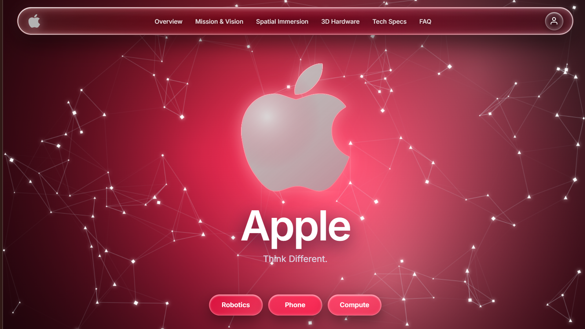

# Apple Blueprint 1.0 — Frontier Product Showcase & Landing Page Template



> **A high-performance, zero-dependency, open-source landing page and product showcase template.**  
> Crafted with vanilla **HTML5, CSS3, and JavaScript** — no build step, no framework bloat, and ready for instant deployment to **GitHub Pages**, **Vercel**, or **Netlify**.

Apple Blueprint 1.0 combines the **Google DeepMind Argon cosmic aurora** aesthetic, **Apple Vision Pro** scroll-pinned immersion, **iOS Liquid Glass** refractive optics, and an interactive **3D Product Roll & Colorway Showcase**.

---

## 🚀 Quick Start (Running Locally)

Because the template utilizes modern canvas pixel shaders, alpha-channel detection for custom logos, and dynamic media pipelines, run it using any local web server:

```bash
# Option 1: Python (Built-in)
python -m http.server 8000

# Option 2: Node.js (npx serve)
npx serve .

# Option 3: VS Code
Click "Go Live" with the Live Server extension.
```

Then open `http://localhost:8000` in your browser.

---

## 🎨 Master Customization Guide for Newcomers

This repository is designed so that anyone can transform it into their own company landing page or flagship product showcase in minutes.

The entire website is controlled by **one configuration file**:  
👉 **[`js/config.js`](js/config.js)** — *the single source of truth for all text, copy, links, theme colors, and product specs.*

Specific directories also include specialized guides:
- **Logo Guide:** [`assets/logo/TOKnow.md`](assets/logo/TOKnow.md)
- **3D Product Images Guide:** [`assets/disassembly/layers/Note.md`](assets/disassembly/layers/Note.md)
- **3D Showcase Architecture:** [`assets/disassembly/README.md`](assets/disassembly/README.md)

---

### 1. Changing Your Brand / Company Logo

You don't need to write any code to replace the logo. The intelligent pipeline in `js/logo-pipeline.js` auto-detects your file and syncs it everywhere simultaneously:

1. Place your logo inside **`assets/logo/`**.
2. Name it **`center-logo.<ext>`** (`.svg`, `.png`, `.webp`, `.avif`, `.jpg`, `.jpeg`, or `.gif`).
3. **How it renders:**
   - **Transparent PNG or SVG:** The engine generates a true 3D refractive glass center logo with caustics and a specular rim traced directly from your artwork's alpha contours.
   - **Opaque Image / JPG:** Framed automatically inside an authentic Liquid Glass app-icon plate.
4. **All-in-one sync:** Your logo automatically updates:
   - The persistent top **Navbar Brand Mark**.
   - The interactive 3D **Hero Centerpiece**.
   - The browser **Tab Icon (Favicon)**.

*(See [`assets/logo/TOKnow.md`](assets/logo/TOKnow.md) for full details on alpha styling and aspect ratios).*

---

### 2. Changing the Cosmic Theme & Color Palette

Change your site's entire color identity with one word in **[`js/config.js`](js/config.js)** under `theme.preset`:

```js
theme: {
  preset: "crimson", // "crimson" | "sapphire" | "purple" | "emerald" | "gold" | "custom"
  custom: {
    voidBg: "#020614",
    primaryAccent: "#2575fc",
    glowAccent: "#60c5ff"
  }
}
```

* **`"crimson"`**: Cosmic Red, Ruby & Warm Ember *(Default)*
* **`"sapphire"`**: DeepMind Cosmic Blue & Icy Cyan
* **`"purple"`**: Cosmic Amethyst, Deep Violet & Orchid Glow
* **`"emerald"`**: Bio-Teal, Mint Glow & Emerald
* **`"gold"`**: Obsidian Solar Gold & Warm Amber
* **`"custom"`**: Any custom hex values you specify

> **Live Preview:** Open your browser console (`F12`) and test themes live without reloading:  
> `window.setBlueprintTheme('sapphire')` or `window.setBlueprintTheme('purple')`

---

### 3. Customizing the 3D Product Showcase (iPhone 18 Pro & Hardware Disassembly)

The **3D Hardware** section (`#hardware-disassembly`) allows visitors to explore your product through three distinct presentation styles:

#### A. Choosing Your Animation Mode (`animationStyle` in `js/config.js`):
You can switch the entire physical motion style with one line:

```js
hardwareDisassembly: {
  // 1. Choose your motion mode:
  animationStyle: "roll-360", // "roll-360" | "flip-360" | "explode"
  ...
}
```

* **`"roll-360"` (Default)**: Continuous 3D orbital perspective roll. As the visitor scrolls or drags, the product smoothly turns through each perspective angle and loops seamlessly (`Layer 1 → Last Layer → Layer 1`).
* **`"flip-360"`**: Precision horizontal turntable spin around the center Y-axis with realistic specular highlights.
* **`"explode"`**: Vertical exploded disassembly teardown! The product layers separate vertically along the Y-axis with dynamic drop-shadows and dashed laser alignment bus lines, revealing the internal engineering components.

> **Live Preview (DevTools Console):** Press `F12` and switch modes live without reloading:  
> `setHardwareAnimation('explode')`  
> `setHardwareAnimation('roll-360')`  
> `setHardwareAnimation('flip-360')`

#### B. Adding Your Product Images:
1. Create a folder under `assets/disassembly/layers/<your-product>/<Colorway>/` (e.g. `iphone18pro/Burgundy/` and `iphone18pro/Glacier/`).
2. Follow the Canva standardization guide in **[`assets/disassembly/layers/Note.md`](assets/disassembly/layers/Note.md)**:
   - **Canvas size:** `1200 × 1600 px` (portrait 3:4).
   - **Product height:** Keep the product centered and filling ~85% of canvas height so angles line up pixel-perfect.
   - **Format:** Transparent PNG (or clean white studio background).
   - **Naming:** `layer-1.png` (front view / top layer), `layer-2.png`, `layer-3.png`, etc.
3. Configure your colorways and feature callout pins in **[`js/config.js`](js/config.js)**:

```js
hardwareDisassembly: {
  eyebrow: "iPhone 18 Pro",
  headline: "Every angle forged with surgical precision.",
  animationStyle: "roll-360", // "roll-360" | "flip-360" | "explode"
  defaultColorway: "burgundy",

  colorways: [
    {
      id: "burgundy",
      label: "Burgundy",
      swatch: "#7a1f34",
      glow: "#c2365a",
      folder: "./assets/disassembly/layers/iphone18pro/Burgundy/",
      layers: [
        { pin: { x: 0.50, y: 0.40, title: "Super Retina XDR display", detail: "6.9″ or 6.3″" }, spreadFactor: -1.5 },
        { pin: { x: 0.50, y: 0.30, title: "Action button & titanium frame", detail: "Customisable controls" }, spreadFactor: -0.5 },
        { pin: { x: 0.36, y: 0.22, title: "48MP Pro Fusion camera", detail: "Triple-camera system" }, spreadFactor: 0.5 },
        { pin: { x: 0.50, y: 0.40, title: "Camera Control", detail: "Variable aperture ƒ/1.48 – ƒ/4.0" }, spreadFactor: 1.5 }
      ]
    },
    {
      id: "glacier",
      label: "Glacier",
      swatch: "#b9cde6",
      glow: "#8fb6e8",
      folder: "./assets/disassembly/layers/iphone18pro/Glacier/",
      layers: [
        { pin: { x: 0.50, y: 0.40, title: "Super Retina XDR display", detail: "Front optics" } },
        { pin: null }, // 45° transition angle (no pin callout)
        ...
      ]
    }
  ],

  specCard: {
    title: "iPhone 18 Pro",
    body: "Pro in every direction. Drag the phone to roll it, or pick a finish below.",
    specs: [
      { label: "Display", value: "6.9″ or 6.3″ Super Retina XDR" },
      { label: "Chip", value: "A20 Pro • 7-core GPU with Neural Accelerators" },
      { label: "Rear Camera", value: "48MP Pro Fusion: Main, Ultra Wide & Telephoto" },
      { label: "Battery", value: "Up to 45 hours video playback" }
    ]
  }
}
```

#### C. User Interaction Mechanics:
- **Desktop / Laptop:** Scrolling the section runs the complete 360° loop: `Layer 1 → Last Layer → Layer 1`, then unlocks standard page scrolling. Users can also click and drag horizontally on the canvas to inspect any angle freely.
- **Mobile / Touch Devices:** The scroll runway is automatically disabled (`trackHeightVh: 'auto'`) to prevent scroll locks. Visitors swipe the product horizontally to roll it in an endless loop (`swipe left` = roll forward, `swipe right` = roll backward).
- **Liquid iOS Color Buttons:** Clicking any finish re-skins the product, recolors the stage studio glow, and updates the spec card badge. Live console test: `setProductColor('glacier')`.

---

### 4. Customizing Text, Images & Bento Galleries

All copy and imagery across the remaining sections are easily edited in `js/config.js`:

| Section | Image Folder | What You Can Customize |
| :--- | :--- | :--- |
| **Hero Section** | `assets/logo/` | Slogan (`title`, `subtitle`), constellation particle density, and 3 CTA pills (`hero.ctas`). |
| **Bento Grid** | `assets/bento/` | 4 modular cards (`bento-1.jpg` … `bento-4.jpg`) highlighting Mission, Vision, Philosophy, and Strategic Goals (`bentoSection`). |
| **Spatial Immersion** | `assets/immersion/` | 3 fullscreen scroll-pinned blur-to-clear showcases (`section-1-bg.jpg` … `section-3-bg.jpg`). |
| **Editorial Bento Carousels** | `assets/editorial/` | High-contrast Apple-style carousels (`sec1-card1.jpg` …). Supports edge-docked hardware close-ups (`dock: "left"`), MP4 video loops, and MP3 audio equalizers! |
| **Tech Specs Modal** | — | Side-by-side flagship hardware comparison tables (`techSpecsModal`). |
| **Interactive Authentication** | — | Pop-out OAuth account chooser (Google, Apple, Facebook, SSO), 2FA OTP verification, and simulated Welcome Email dispatch. |
| **Accordion FAQ** | — | Clean expandable Q&A items (`accordionSection`), default closed. |

---

## 📁 Repository Structure

```
apple-blueprint-1.0/
├── index.html                 # Semantic HTML shell with micro-optimizations
├── README.md                  # <-- Main project guide (this file)
├── TASK.md                    # Engineering progress log, architecture & AI reference
├── css/
│   └── styles.css             # Liquid Glass optics, responsive typography, canvas layouts
├── js/
│   ├── config.js              # MASTER CONFIG — all copy, colors, links, images, product specs
│   ├── logo-pipeline.js       # Auto-detects custom logo, alpha sampling, tab favicon, theme sync
│   ├── hero-aurora.js         # Multiphase cosmic aurora ribbons + break/relink constellation
│   ├── scroll-immersion.js    # Sticky blur-to-clear stages, Bento carousels, modals, FAQ
│   └── hardware-disassembly.js# 3D product roll engine, colorway switcher, drag/swipe physics
└── assets/
    ├── logo/                  # Centerpiece & navbar logo (read TOKnow.md)
    ├── disassembly/layers/    # Multi-angle product images by color (read Note.md)
    ├── bento/                 # 4 corporate foundation images (bento-1.jpg .. bento-4.jpg)
    ├── immersion/             # Fullscreen backdrops (section-1-bg.jpg .. section-3-bg.jpg)
    └── editorial/             # Carousel cards (sec1-card1.jpg .. sec3-card2.jpg)
```

---

## 🚢 Deployment to Vercel & GitHub Pages

Because Apple Blueprint 1.0 has **zero build dependencies**, deployment takes under 60 seconds:

### Deploy to Vercel
1. Push this repository to your GitHub account.
2. Go to [vercel.com/new](https://vercel.com/new) and import the repository.
3. Leave **Build Command** and **Output Directory** blank (static project).
4. Click **Deploy**.

### Deploy to GitHub Pages
1. Go to your repository **Settings** → **Pages**.
2. Under **Build and deployment** > **Source**, choose **Deploy from a branch**.
3. Select `main` branch and `/ (root)` folder, then click **Save**.

---

## 🛠️ Browser Compatibility

- **Desktop:** Chrome, Safari, Edge, Firefox, Brave, Arc (Hardware accelerated 60fps).
- **Mobile & Tablet:** iOS Safari (iPhone 14/15/16 Pro, iPad Pro), Android Chrome (Pixel, Samsung Galaxy). Fully responsive with `overflow-x: clip` viewport stabilization.

---

## 📄 License

Open-source and free to customize for commercial, startup, and personal portfolio showcases.
